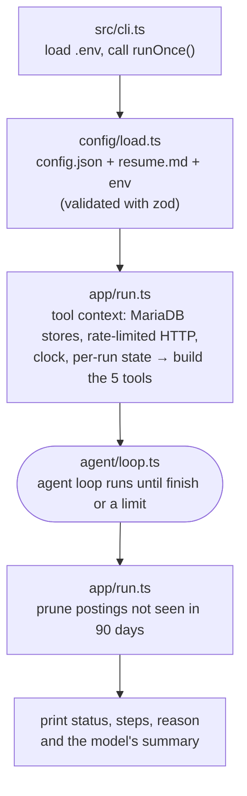
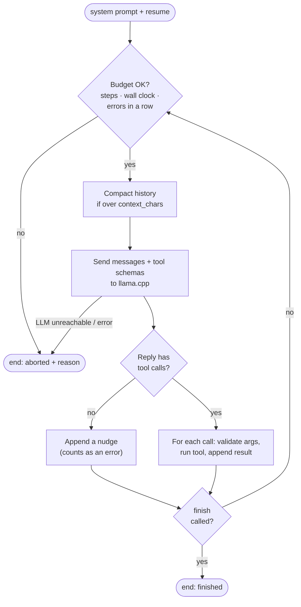
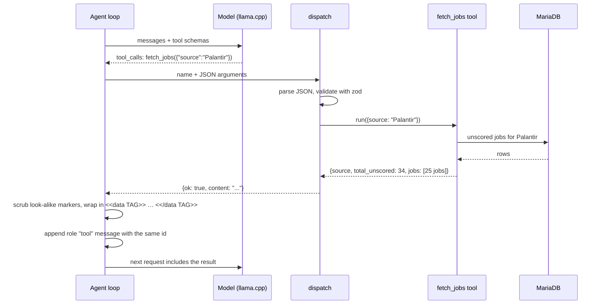
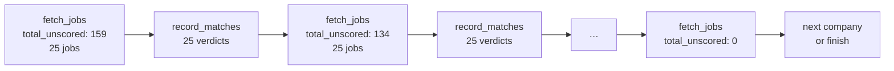
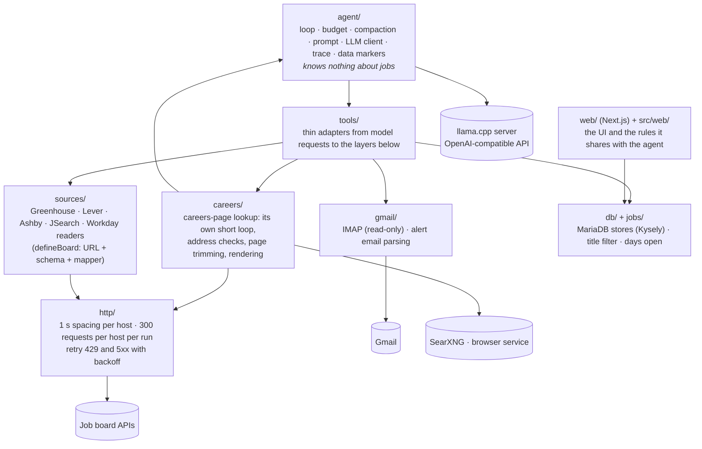
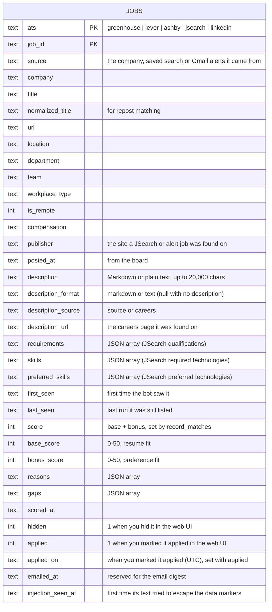
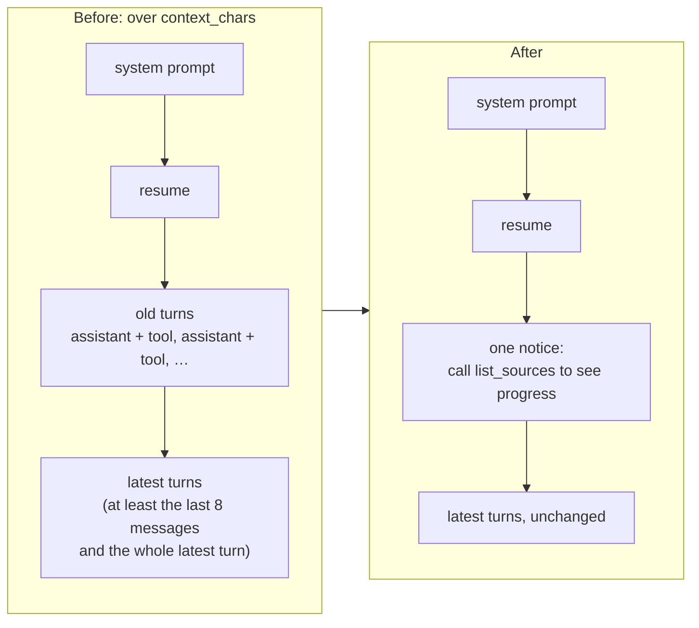

# myjobbot

An autonomous agent that pulls software-engineering postings from company job boards
(Greenhouse, Lever, Ashby), saved JSearch searches (Google for Jobs: LinkedIn, Indeed and more)
and your LinkedIn job-alert emails, looks up missing descriptions on employers' own careers pages,
scores every job against your resume with a local LLM, and keeps history in MariaDB to spot
long-open "ghost" postings. A web UI lists the results and explains each score.

Design: `docs/superpowers/specs/2026-10-03-myjobbot-design.md`

## Setup

```bash
npm ci
cp .env.example .env            # set LLM_API_KEY and the MYJOBBOT_DB_* settings (see Storage)
mkdir -p data
cp examples/config.json data/   # list your target companies
cp examples/resume.md data/     # replace with your resume
```

The LLM server must be llama.cpp `llama-server` started with `--jinja` and a
tool-calling model.

## Storage

Jobs, scores, verdict history and the JSearch request log live in MariaDB (10.11 or later),
reached through [Kysely](https://kysely.dev) typed queries. `data/` keeps only `config.json`,
`resume.md`, run traces and logs.

1. **Create two databases**, `myjobbot` and `myjobbot_test`, both `CHARACTER SET utf8mb4` with the
   same collation (any; the tables set their own), and a user with rights on just those two.
2. **Set in `.env`**: `MYJOBBOT_DB_HOST`, `MYJOBBOT_DB_USER`, `MYJOBBOT_DB_PASSWORD`, and
   optionally `MYJOBBOT_DB_PORT` (3306) and `MYJOBBOT_DB_NAME` (`myjobbot`).
3. **Start anything**: the agent and the web UI create or update the tables on first use. Each
   schema change is a numbered step in `src/db/migrations/`, run once per database.

Every table compares text exactly (`utf8mb4_bin`), so job IDs that differ only in letter case
stay distinct, and every connection sets `utf8mb4`, so accents and emoji survive. Backups are the
MariaDB server's job.

**Coming from SQLite?** Copy the old database across once, with the agent stopped:

```bash
sqlite3 data/myjobbot.db ".backup 'data/myjobbot-pre-mariadb.db'"
npm start -- import-sqlite data/myjobbot-pre-mariadb.db
```

The import is all or nothing. It refuses a database that already has rows, and any value too long
for its column, and it checks counts and a sample before committing.

## Run

```bash
npm start -- run
```

Each run gets a UUID (printed as `run <id> finished after …`). Every log line carries it as
`run_id`, and every file name ends with it, so one run's files sort together:

| File | One line per |
|---|---|
| `data/runs/<timestamp>-<run_id>.jsonl` | Trace event: starting messages, model replies, tool calls and results, nudges, compactions, end |
| `log/<timestamp>-<run_id>.llm.jsonl` | Raw LLM response, including token usage and llama.cpp timings |
| `log/<timestamp>-<run_id>.jobs.jsonl` | Board download: company, board, job count, and the normalized jobs (descriptions omitted) |

Set `MYJOBBOT_LOG_DIR` to move the `log/` folder.

## Web UI

```bash
npm run web          # development server, http://localhost:8080
npm run web:build && npm run web:start   # production build and server
```

A Next.js app for browsing the database, with three tabs and a Settings page (see [Gmail](#gmail)):

| Tab | Shows |
|---|---|
| **Recommended** | Jobs from your configured sources scoring at or above `match_threshold` (after boosts), most recently posted first, with the model's reasons and gaps |
| **All jobs** | Every job retrieved, scored or not, most recently posted first, including ones the title filter or `exclude_companies` hid from the model |
| **Reasoning** | Every scoring decision with its run ID, newest first. Kept as history in the `verdicts` table, so re-scoring never overwrites the earlier reasoning |

Each job row has a **Hide** button. Hiding sets the job's `hidden` flag: it disappears from
Recommended at once and stays hidden when the posting is fetched again. All jobs still lists it,
dimmed, with an **Unhide** button.

Each row also starts with an **Applied** column: a blue **?** until you've applied, which you click
to mark the job applied, and then a green **✓**. Hovering the check shows the date you marked it, in
your browser's time zone. Clicking the check asks "Mark as not applied?" and, if you confirm, clears
the mark. Applied and Hide are independent: marking a job doesn't move it on or off Recommended or
change its score, and the mark stays through runs and re-scoring. Hiding, marking a job applied, and the Gmail panel on Settings
are the UI's only writes; they accept requests from its own pages only.

**Job details.** On Recommended and All jobs, a job's title opens a panel from the right, over
about 60% of the window, without leaving the list: you can still scroll, hide jobs or click
another title to switch. Its header, beside the title, has a green **Applied** button (which becomes
**Applied ✓**, and undoes the mark after the same confirmation), **Hide** (which hides the job as its
row's Hide does and closes the panel; it is greyed out for a job already hidden, which you bring back
with Unhide on All jobs) and **Close**. The panel has five sections:

- **Job**: company, location, remote and workplace terms, pay, source, posting age, whether
  you hid it, and when you marked it applied.
- **Score**: the total, the model's own score and any title boost, the resume-fit and
  preference-fit parts, and the reasons and gaps.
- **Description**: the full text, with requirements and skills, and where it came from (the job's
  own listing, or the careers page the [careers lookup](#careers-lookup) found, linked). Descriptions
  stored as Markdown show formatted (headings, lists, emphasis, links opening in a new tab); plain
  text shows with its line breaks. See [How descriptions are stored](#how-descriptions-are-stored).
- **Warnings**: only when text from the job tried to escape the model's data markers.
- **History**: every score the job has had, newest first, with its parts and run.

Close it with its button, Escape or a click outside it. The open job is in the address
(`?job=<board>:<id>`), so reload, back and forward keep it, and Ctrl/Cmd-click opens a job in a new
tab. The icon left of **Hide** opens the original posting. Reasoning keeps its titles as links to
the posting.

On Recommended and All jobs, hover over a score (or tab to it) for its breakdown ("base 38 +
bonus 40", plus any boost); Reasoning prints it in full. Titles longer than 64 characters end in
"…", with the full title on hover. See
[How scoring works](#how-scoring-works) for what the numbers mean.

Each tab shows 100 rows and loads the next 100 as you scroll (or via "Load more"). Edits to
`data/config.json` show up on the next page load. Set `MYJOBBOT_PORT` to change the port. There
is no login: keep it on your LAN. The web UI needs no LLM settings, only `data/`.

**Which hosts may connect.** Every request must name the UI in its `Host`, or it gets 421; that
stops other websites reaching it through DNS tricks. By default that's `localhost` and
`127.0.0.1` on `MYJOBBOT_PORT`. To open it from another machine, list every `host:port` you use
in `MYJOBBOT_HOSTS`, for example `MYJOBBOT_HOSTS=myserver.lan:8080,192.168.1.20:8080`.

How it's built:
- **The app lives in `web/`.** Each page is a folder under `web/app/` and is rendered on the
  server, so its first rows are in the HTML. Scrolling, Hide and the Gmail panel's buttons run in
  the browser, and they call server functions in `web/lib/actions.ts` and
  `web/lib/gmailActions.ts`.
- **The server does the deciding.** The rules for scores, boosts and filter notes are shared with
  the agent in `src/web/`, so the browser only lays them out.
- **`myjobbot serve` is gone.** The `myjobbot` command only runs the agent; the UI is started with
  the npm scripts above, or by the Docker `web` service (whose container start mode is also named
  `serve` and runs Next.js).
- **To learn React and Next.js** from this code, see
  [docs/react-walkthrough.md](docs/react-walkthrough.md). It maps each idea to the files that use
  it and ends with exercises.

### Gmail

Settings has a Gmail panel that connects your mailbox over IMAP with an app password. Once it's
connected, every run reads your new LinkedIn job-alert emails and turns their jobs into jobs
myjobbot scores, under the source "Gmail alerts".

How runs use the alerts:
- **What's read**: only new alert mail since the last run (the last 7 days the first time), at
  most the 50 newest per run. The mailbox is opened read-only and only each email's HTML part is
  downloaded, so nothing is marked read, moved or deleted. Email text is never stored, only the
  jobs.
- **Descriptions**: alert emails carry no job description. For new alert jobs that pass the title
  filter, a run makes one JSearch search per alert email (the alert's own keywords) and fills in
  the description for postings it finds. Lookups only use what's left of
  `jsearch.monthly_request_cap` after your saved searches' refreshes for the rest of the month.
  Jobs without a description are still scored, and their gaps say "scored from the alert only".
- **Duplicates**: a posting seen again keeps its score and details. One already stored from a
  company board or saved search isn't added again.
- **Visible results**: the Gmail panel shows the last run's counts ("3 alert emails, 14 jobs, 1 not
  understood"). A rising "not understood" count means LinkedIn changed its email layout.
- **Indeed**: Indeed alerts aren't parsed yet; they're counted separately, as unsupported, in
  the run trace.
- **Careers pages**: alert jobs JSearch couldn't describe get a [careers lookup](#careers-lookup)
  when a SearXNG server is configured.

One-time setup:
1. **Turn on 2-step verification** for your Google account, if it isn't on already.
2. **Create an app password** at https://myaccount.google.com/apppasswords (call it "myjobbot")
   and keep the 16 letters Google shows.
3. **Set the server key** in `.env`: `MYJOBBOT_SECRET_KEY=` followed by the output of
   `openssl rand -base64 32`. It seals the app password in the database. If it changes, the panel
   asks for the app password again. It takes effect after `docker compose up -d` (not `restart`)
   or restarting `npm run web`.

To connect, open Settings from any address, enter your Gmail address and the app password
(spaces are fine), and press **Connect**. myjobbot signs in to `imap.gmail.com` first, and
saves the pair only if that works. After that:
- **Check now** counts the job-alert emails of the last 7 days in All Mail and lists the newest
  five. It opens the mailbox read-only, so nothing is marked read, moved or deleted.
- **Disconnect** forgets the address and app password. To revoke access, also delete the app
  password at the same Google page.

The senders that count as job alerts are `gmail.alert_senders` in `data/config.json`. An app
password gives full access to the mailbox (Google has no read-only kind), and myjobbot only ever
reads it. The web UI has no login, so anyone on your LAN can connect or disconnect. The stored app
password can't be read back through it.

### Careers lookup

Alert jobs arrive with a title, company and location but no description, so the model has little
to score. When `MYJOBBOT_SEARXNG_URL` is set, fetching the Gmail alerts source looks those jobs up
on the employer's own careers page before the agent scores them:

1. **Which jobs**: unscored alert jobs that pass the title filter, still have no description
   after JSearch, and haven't been looked up before. At most `careers_lookup.max_per_run` a run,
   and `careers_lookup.max_total_minutes` in total, one at a time. Jobs whose lookup before 010
   ended on an unreadable page (or gave up) get one more try, even if they were scored since; a
   description found that way makes the job be scored again.
2. **How**: each job gets its own short conversation with the model, with three tools:
   `search_careers` (SearXNG, "<company> careers"), `open_link` (opens a numbered link as a careers
   page or as the job's own page, at most 4 per job) and `finish_lookup`. The model picks among
   numbered links; it **never types an address**. The code only opens public `http(s)` addresses
   on the default port, checks every redirect again, and refuses anything on your LAN. Search
   results on aggregators (`careers_lookup.skip_hosts`: Glassdoor, ZipRecruiter, Indeed,
   LinkedIn, Built In, Teamwork Online) are dropped, a second search in one lookup is refused, and
   a page that fails to open is reported to the model without ending the lookup.
3. **Pages are trimmed** before the model sees them: scripts, styles, navigation, headers,
   footers, forms and hidden elements go, leaving text and job links, at most
   `careers_lookup.page_chars` (12,000) characters. With up to four pages a lookup can pass the
   56,000-character context budget, in which case the oldest page is compacted away, so it fits a
   model served from a 16GB graphics card.
4. **Results**: a found job page becomes the job's description, as Markdown converted from the
   page's HTML without its navigation, header, footer or hidden parts (or, from a board's own data,
   the posting's own description), and the agent scores it as usual (`get_job_details` says
   `description_from: "careers page"`). The careers page that
   led to it is remembered for the company, so later jobs there skip the search.

**How a page is read**, in order (each open's audit row says which, in `page_source`):

1. **Board data**: links on Ashby, Greenhouse, Lever and Workday (`*.myworkdayjobs.com`) are read
   from the board's own published data, through the same readers as the job-board sources (plus a
   Workday reader). A careers page becomes the board's job list (Workday: its search for the
   sought title), a job page the posting itself. If that fails, the page is downloaded instead
   (`fallback = 'board_failed'`).
2. **Download**: the page's HTML, trimmed.
3. **Rendering**: when the download is unreadable (a job page with no text, or a careers page
   with no job links, as JavaScript-built sites give), the page is rendered in a browser service
   and trimmed the same way. Every request the page makes is checked against the same address
   rules, redirects included; images, fonts and media aren't loaded; each page gets a fresh
   browser context; rendering stops after `careers_lookup.render_seconds`. Without a browser
   service (`MYJOBBOT_BROWSER_URL` unset) or after it fails once in a run, unreadable pages stay
   empty (`fallback = 'render_off'` / `'render_failed'`) and the run summary says so.

Following a listing's next pages isn't done yet; the audit log notes when a page seems to continue.

**Browser service**: run the bundled one with `docker compose --profile browser up -d browser` and
set `MYJOBBOT_BROWSER_URL=ws://browser:3000/`, or point at a Playwright server elsewhere. It must
be Playwright **1.64.1**, the same version as `playwright-core` in `package.json`; upgrade both
together. The bundled service sits on its own Docker network (`172.31.250.0/24`) with no published
port. The address checks are the protection; as a second line of defence, keep that network off
your LAN on the Docker host:

```bash
sudo iptables -I DOCKER-USER -s 172.31.250.0/24 -d 10.0.0.0/8,172.16.0.0/12,192.168.0.0/16 \
  -m conntrack --ctstate NEW -j DROP
```

and set `careers_lookup.lan_probe_url` to a LAN address that answers (your router, say): each
run's first rendering then checks the browser can't reach it, and writes a `render_check` audit
row with `warning = 1` (rendering still goes ahead) if it can.

**SearXNG**: use your own server, or the bundled one: set `SEARXNG_SECRET` in `.env`, start it
with `docker compose --profile search up -d searxng`, and set
`MYJOBBOT_SEARXNG_URL=http://searxng:8080`. It has no published port. Either way, SearXNG must
answer JSON: `search.formats` in its `settings.yml` must include `json` (the bundled
`docker/searxng/settings.yml` does). Otherwise searches fail with HTTP 403, and the run notes it.

**Audit log**: every step is a row in `careers_audit` (addresses and sizes, never page text).
Every lookup that ends without a description has `warning = 1` and a fixed `reason`:

```sql
SELECT reason, COUNT(*) FROM careers_audit WHERE warning = 1 GROUP BY reason;
SELECT at, company, step, outcome, reason, url FROM careers_audit ORDER BY id DESC LIMIT 50;
SELECT * FROM careers_pages;
```

## Develop

```bash
npm run check      # typecheck + unit and UI tests + habit-hooks
npm run check:db   # integration tests against myjobbot_test (needs the MYJOBBOT_DB_* settings)
```

Most tests run on in-memory stores; the same store contract runs against MariaDB in
`tests/integration/`, which only ever touches the test database (`myjobbot_test`, or
`MYJOBBOT_TEST_DB_NAME`, which must end in `_test`).

The real-browser rendering test runs only when `MYJOBBOT_TEST_BROWSER_URL` names a Playwright
1.64.1 server that can reach the test's own `127.0.0.1` server, so not the compose `browser`
service. A throwaway one:

```bash
docker run --rm -d --name pw-test --network host --init --user pwuser --workdir /home/pwuser \
  mcr.microsoft.com/playwright:v1.64.1-noble npx -y playwright@1.64.1 run-server --port 3001 --host 127.0.0.1
MYJOBBOT_TEST_BROWSER_URL=ws://127.0.0.1:3001/ npm run check:db
docker stop pw-test
```

## Deploy with Docker

On the server:

```bash
git clone <repo> myjobbot && cd myjobbot
cp .env.example .env              # set LLM_API_KEY, MYJOBBOT_HOSTS and MYJOBBOT_DB_*; optionally SCHEDULE and TZ
mkdir -p data
cp examples/config.json data/     # your companies
cp examples/resume.md data/       # your resume
docker compose up -d --build
```

The container runs `myjobbot run` on `SCHEDULE` (default `0 1/8 * * *`, every 8 hours from
1 a.m.: 01:00, 09:00, 17:00) in `TZ` (default `America/Los_Angeles`, Pacific time). After a board's backlog is scored,
each run only scores new postings; a run never starts while the previous one is still going.
Jobs and scores go to MariaDB (see Storage); `runs/` traces and `log/` files go to the host
`data/` folder. Both containers reach the database over the network, so there is no database
container.

| Task | Command |
|---|---|
| Open the web UI | `http://<server>:8080` (the `web` service; `MYJOBBOT_PORT` in `.env` changes the port) |
| Run once now | `docker compose run --rm myjobbot run` |
| Watch runs | `docker compose logs -f myjobbot` |
| Update after `git pull` | Nothing for code under `src/` or `web/`; `docker compose up -d --build` when `package.json`, `package-lock.json`, `Dockerfile`, `docker/`, `web/next.config.ts` or `web/tsconfig.json` changed (or leave `npm run docker:watch` running) |
| Start (or update) the stack | `npm run docker:up` (`docker compose up -d --build`) |
| Start and rebuild automatically | `npm run docker:watch`: starts the stack, then runs `docker compose watch` in the foreground. Ctrl-C stops only the watcher; the stack keeps running |
| Stop | `docker compose down` |

Both services mount the host's `src/` read-only over the image's copy, so code changes need no
rebuild: each scheduled run starts a fresh process. The `web` service runs Next.js's development
server (`next dev`) on the host's `web/` and `src/`, so a saved change shows on the next reload.
It needs `MYJOBBOT_HOSTS` in `.env` and refuses to start without it. Its `web/` mount is writable,
because Next.js writes its build output (`web/.next-docker/`, gitignored) and `web/next-env.d.ts`
there. Without the mounts (plain `docker run`), the image's own copy of the code is used.

Dependencies are different: `node_modules` is baked into the image, so new code that imports a
new package crashes both services until the image is rebuilt. `npm run docker:watch` (or
`docker compose watch`) rebuilds the image and recreates both containers whenever
`package.json`, `package-lock.json`, `Dockerfile`, `docker/`, `web/next.config.ts` or
`web/tsconfig.json` changes. Two limits: it only
works while that command is running (a reboot or a plain `up -d` leaves nothing watching), and
recreating `myjobbot` stops a scheduled run that is in progress (check with
`docker compose top myjobbot` before changing dependencies near 01:00, 09:00 or 17:00).

The container runs as uid 1000. If your server user has a different uid, run
`sudo chown -R 1000:1000 data`. If the container can't resolve the LLM host (LAN-only DNS),
add `extra_hosts: ["llm.home.arpa:192.168.1.50"]` to the service in `compose.yaml`.

`tests/docker.sh` builds the image and checks the container's behaviour (needs Docker).

---

## How it works

### The big idea

myjobbot is **an LLM in a loop with tools**. The model never touches the internet or the
database directly. It can only ask to call one of five tools. The TypeScript code decides
whether that's allowed, runs it, and hands the result back. The [careers lookup](#careers-lookup)
reuses the same loop for a short side conversation per job, with three tools of its own; even
there the model only picks numbered links, and the code decides which addresses may be opened.

**Outside text is fenced off as data.** Job boards, alert emails and web pages are written by
other people, and any of them could carry instructions aimed at the model. Every result of a tool
that returns such text (`fetch_jobs`, `get_job_details`, `search_careers`, `open_link`) reaches
the model between two markers, `<<data TAG>>` and `<</data TAG>>`, where `TAG` comes from the
run's random id, so nothing written before the run can match it. Both system prompts say that
anything between the markers is data to read, never instructions to follow. Before wrapping, the
code removes anything in the text that looks like a marker, so the text can't close its own
block early; the job it came from gets a "⚠ tried to escape the data markers" note in the web UI,
and is still scored normally. This is a second layer: budgets, numbered links, address checks and
score ranges stay enforced in code whatever the model reads. Text that spells a marker with
look-alike Unicode characters or a typed-out escape sequence isn't caught.

- **The model** decides what to do next.
- **The code** does the work and enforces every limit.

### One run, start to finish



### The loop

The loop lives in `src/agent/loop.ts`, a little over 100 lines. It starts with two messages:
the system prompt (the rules for the job, from `src/agent/prompt.ts`) and your resume.
Then it repeats one step.



A typical run makes this sequence of calls:

```
list_sources → fetch_jobs → record_matches → fetch_jobs → record_matches → … → fetch_jobs → finish
```

### A tool call, up close

Every tool is defined with a zod schema (`src/tools/tool.ts`). `defineTool` turns it into
JSON Schema, which goes to the model in the `tools` field of every request. That is how the
model knows `fetch_jobs` takes `{source: string}`.



Every tool declares whether its results carry outside text (`outsideText` in `defineTool`).
For those, the loop (`src/agent/wrapped.ts`) wraps the result in the run's data markers before
the model sees it; the trace keeps the result as it was, with `wrapped: true`.

**Errors are data, not crashes.** `dispatch` never throws. Bad arguments, an unknown tool,
or a board that's down all come back to the model as `{"error": "…"}` (capped at 2,000
characters), so the model can correct itself. That self-correction is most of why agents
work. Three failures in a row and the code ends the run.

### The five tools

| Tool | What it does |
|---|---|
| `list_sources` | Each company board and saved search, plus "Gmail alerts", with this run's progress: `fetched`, `total_unscored`, `fetch_failed` (with a `note` saying why, for Gmail alerts) |
| `fetch_jobs` | The first call per source per run downloads the board, calls JSearch if the search is due, or reads new Gmail alert emails. Every call returns **at most 25** unscored jobs that pass the title filter, plus `total_unscored`; search pages also say whether they were refreshed, and the alerts page carries the run's alert counts |
| `record_matches` | Saves up to 25 verdicts in one call: a `base` (0–50, resume fit) and a `bonus` (0–50, preference fit) that code sums into the score, with reasons and gaps |
| `get_job_details` | One job's metadata plus its description (first 6,000 characters, Markdown without link addresses, or plain text) and any requirements and skills. The prompt asks the model to call it for jobs that look like a plausible fit before scoring them; the result arrives inside the run's data markers |
| `finish` | Records the model's summary and ends the loop. Refused, with a list of what's left, while any source is unfetched or still has unscored jobs (a source whose fetch failed doesn't count) |

**Paging needs no page numbers.** The model scores a page and calls `fetch_jobs` again.
The database only returns jobs that are still unscored, so each call gets the next batch
until `total_unscored` is 0.



The board is downloaded only on the first `fetch_jobs` call per company per run. Later
calls reuse that download and just query the database. A failed download isn't cached, so
the next call retries it.

### The plain-code layers

Everything below the agent is ordinary, deterministic code.



- **Sources:** each adapter is a URL, a zod schema for the board's response, and a mapper
  to a common `Job` shape.
- **HTTP:** requests to the same site are at least 1 second apart and capped at 300 per site per run,
  and 429 and 5xx responses are retried with backoff that honors `Retry-After`. A looping
  agent can't hammer a job board.
- **Title filter:** postings like sales, recruiting and management are stored but never
  shown to the model, which saves steps. Include terms match word prefixes ("engineer"
  matches "Engineering"); exclude terms match whole words ("intern" rejects "Interns" but
  not "Internal"). Setting `exclude` replaces the default list; to keep the defaults and add
  your own terms, use `extra_exclude`.

### What a job row remembers



Company boards and JSearch save the job description (see below). Alert emails carry none: an alert job takes the description of a matching JSearch result,
or the one the [careers lookup](#careers-lookup) finds, and otherwise has none
(`description_source` says which). JSearch also supplies requirement bullets and required and
preferred technologies, which are saved when present; the other sources don't have them as lists,
so those columns stay empty. Each scoring decision is also kept in the `verdicts` table (see
[How scoring works](#how-scoring-works)).

#### How descriptions are stored

Sources that send HTML have it converted to **Markdown** before it is stored
([turndown](https://github.com/mixmark-io/turndown), `src/descriptions/toMarkdown.ts`), so the
posting's headings, lists and emphasis survive:

| Source | What is stored |
|---|---|
| Greenhouse | Markdown from its HTML (sent escaped, decoded once) |
| Ashby | Markdown from `descriptionHtml` |
| Lever | Markdown of the whole posting: the opening, each list ("Requirements"…) under its own heading, then the closing section |
| Careers lookup | Markdown of the job page (a Workday or other board page's own posting, or the downloaded or rendered page without its menus, header, footer or hidden parts) |
| JSearch | Plain text, as JSearch sends it |

`description_format` says which a row holds; rows stored before Markdown, and JSearch's, stay
plain text and always show as plain text.

- **Only safe formatting is kept.** Scripts, styles, frames, forms, media and images are dropped
  with their contents; other wrappers keep their text; links are kept only for `http(s)` addresses;
  text that merely looks like HTML or Markdown is escaped. At most 20,000 characters, cut at a line
  break.
- **It is shown safely.** The panel renders it with
  [react-markdown](https://github.com/remarkjs/react-markdown): raw HTML is never interpreted, no
  images load, and only `http(s)` links become links (new tab, no referrer).
- **The model reads a link-free copy.** `get_job_details` and title boosts see the Markdown with each
  link reduced to its words, so a link to `aws.example.com` doesn't count as "aws".
- **Scored again once.** The first time a scored job's description changes to Markdown, it is marked
  for scoring again, keeping its current score until then.
- **Only configured boards change.** Stored jobs from companies no longer in `data/config.json` are
  never fetched again, so they keep their plain text.

**Fishing-post detection:** "days open" counts from the oldest date the bot has, either
`posted_at` or `first_seen`, across all rows with the same company and normalized title.
That way a job reposted under a new ID still shows its true age. Over 60 days
(`ghost_threshold_days`) sets `possible_ghost: true`, and the model lowers its score a
little. Rows not seen for 90 days (`job_retention_days`) are pruned after each run, except jobs
you've marked applied, which are kept with their scoring history.

### Context compaction

Long runs would overflow the model's context, so history is trimmed. This is safe because
**the database, not the conversation, is the agent's memory**: tools always return current
state.



- The kept part always starts on an assistant message, so no tool result is left without
  the request that produced it.
- Later overflows fold the old notice in, so the start of the conversation (system prompt,
  resume, notice) stays byte-identical and llama.cpp's prompt cache keeps working.
- After compaction the model calls `list_sources` to see which sources are done.

### How scoring works

A job's score is decided in four stages. Only the third involves the model.

**1. Filters decide what the model sees** (before scoring, in code). `fetch_jobs` offers only
jobs whose title passes `title_filter` (an include term, matched at the start of a word, and no
exclude term, matched as a whole word) and whose company isn't in `exclude_companies`. Filtered jobs are stored but never
scored; All jobs marks them.

**2. The model reads what looks promising.** `fetch_jobs` returns metadata only. For each job
whose title, seniority and location could plausibly fit, the prompt asks the model to call
`get_job_details` and read the description (first 6,000 characters) before scoring.

**3. The model scores with a rubric, in two parts** (`src/agent/prompt.ts`). For each job it
returns a `base` and a `bonus` to `record_matches`; code checks each is an integer from 0 to
50 and stores their sum as the score, keeping both parts.

| Part | Points | Rubric |
|---|---|---|
| **Base: fit with your resume** | **0–50** | |
| Stack | up to 25 | 20–25: the job's main languages and frameworks are ones the resume shows. 10–19: partial overlap or close neighbours. 0–9: mostly a different stack |
| Level | up to 15 | 15: the seniority the resume shows. 8: one step off. 0–4: far off (junior, or principal and director scope) |
| Kind of work | up to 10 | 10: the kind of work the resume shows strength in. 5: adjacent. 0: unrelated |
| **Bonus: fit with your `preferences`** | **0–50** | |
| Location | up to 25 | 25: location or remote terms the preferences ask for. 0: anything else, including remote roles limited to another country |
| Role | up to 15 | 15: the role and level the preferences ask for; less for roles the preferences say to score low |
| Other preferences | up to 10 | Anything else the preferences mention |

If the preferences say to score a job 0 (for example a company you won't work for), both parts
are 0. With a base of at most 50, a job needs bonus points to reach `match_threshold`: at a
threshold of 60, a perfect base still needs 10 bonus points; at 70 it needs 20, which in
practice means the location has to fit. Reasons and gaps are required from a score of 40 and
should name the rubric parts behind the numbers. `possible_ghost` (open over 60 days) lowers
the base slightly.

The rubric is written in terms of "the resume" and "the preferences", never specific
technologies, so editing `data/resume.md` or the `preferences` text changes what counts as a
fit without touching the prompt.

**4. Boosts and your choices adjust what's shown** (at display time, in the web UI). Each
`title_boosts` term found as a whole word in the title or description adds its points once,
capped at 100 ("model 62 · +10 typescript"). Recommended shows jobs whose boosted score is at
or above `match_threshold`, minus excluded companies and jobs you hid. None of this is stored,
so changing boosts or the threshold re-sorts every job on the next page load, without
re-scoring. The Reasoning tab always shows the model's own score.

**Every verdict is kept.** Each `record_matches` call also appends to the `verdicts` table with
the run ID, so re-scoring a job (for example after changing the rubric) never loses what the
model said before.

**What to expect from the model.** Scores come from a local 30B model sampling at temperature
0.7, so the same job can score differently on another run, and reasons are occasionally wrong.
The rubric narrows that spread; treat a score as a sort order, not a verdict.

### Design lessons built into it

1. **Limits live in code, not the prompt.** The step cap, the time cap, the error streak and
   the nudge are all enforced in `agent/budget.ts` and `agent/loop.ts`, and `finish` is
   refused while any source is unfetched or still has unscored jobs. The model can't argue
   its way past them.
2. **The database is the memory.** That's what makes compaction safe, and it's why a crashed
   run loses nothing: unscored jobs are offered again on the next run.
3. **Keep the prompt prefix stable** so a local model's prompt cache stays warm.
4. **The loop knows nothing about jobs.** Job knowledge lives in the tools and
   `agent/prompt.ts`. The same loop could run a different agent, and a fixed-order pipeline
   could call the same tools if the agent approach ever proves unreliable.
5. **Everything is traced.** Every model reply, tool call, nudge and compaction is appended
   to `data/runs/<timestamp>-<run_id>.jsonl`.

### Configuration knobs (`data/config.json`)

| Setting | Default | What it controls |
|---|---|---|
| `companies` | `[]` | `{name, ats, slug}` per company board (at least one company or search) |
| `searches` | `[]` | Saved JSearch searches: `{name, query, remote_only, country}`. Needs `JSEARCH_API_KEY` |
| `jsearch.monthly_request_cap` | 190 | JSearch requests allowed per calendar month (free tier is 200) |
| `jsearch.refresh_hours` | 24 | Each search calls JSearch at most once per this many hours (with 15 minutes' leeway, so runs exactly this far apart always refresh). Set it to the gap between scheduled runs to refresh on every run |
| `jsearch.date_posted` | `3days` | Only postings this recent: `today`, `3days`, `7days`, `30days` |
| `jsearch.exclude_publishers` | `[]` | Job boards whose JSearch results are dropped before storing. A name matches the publisher as whole words, any case: `"dailyremote"` drops results published by DailyRemote (use full board names: `"remote"` would also drop Remote Rocketship). An entry with a dot is a domain matched against the apply link's host: `"jobmesh.io"` drops links on exactly `jobmesh.io`, and `"*.trabajo.org"` drops `trabajo.org` and every subdomain. So `"remote.co"` matches by link, not by name. A malformed domain, or a bare suffix like `"*.com"`, stops the app at startup |
| `preferences` | `""` | Free text added to the system prompt |
| `match_threshold` | 70 | Score at which a job counts as a match |
| `ghost_threshold_days` | 60 | Days open before `possible_ghost` |
| `job_retention_days` | 90 | Days unseen before a job row is pruned (must exceed the ghost threshold); jobs marked applied are never pruned |
| `title_filter.include` / `.exclude` | engineering terms / sales, recruiting, management, interns | Which postings the model sees |
| `title_filter.extra_exclude` | `[]` | More exclude terms, added to `exclude` instead of replacing it |
| `exclude_companies` | `[]` | Company names to hide (whole words, any case: `"nvidia"` hides "NVIDIA Corporation"). Their jobs are stored but never scored, and they drop out of Recommended |
| `title_boosts` | `{}` | Points (1-100) added to the score when a term appears as a whole word in the title or description (each term counted once) |
| `agent.max_steps` | 600 | Step cap per run |
| `agent.max_wall_clock_min` | 120 | Time cap per run |
| `agent.max_consecutive_tool_errors` | 3 | Errors in a row before aborting |
| `agent.context_chars` | 160000 | History size that triggers compaction |
| `http.*` | 1 s spacing, 300 requests per host per run, 2 retries, 30 s timeout | Politeness toward job boards |
| `careers_lookup.max_per_run` / `.max_total_minutes` | 10 / 30 | Careers lookups per run, and the total time they may take |
| `careers_lookup.max_minutes` | 5 | Time budget for one job's lookup (checked between model turns) |
| `careers_lookup.page_chars` | 12000 | Characters of trimmed page (or search results) handed to the model |
| `careers_lookup.search_results` | 10 | SearXNG results offered per company |
| `careers_lookup.max_download_kb` | 2048 | Bytes read from one page before it is cut |
| `careers_lookup.render_seconds` | 15 | Time limit for rendering one page (5–60) |
| `careers_lookup.skip_hosts` | aggregators | Hosts (and their subdomains) whose search results are dropped |
| `careers_lookup.lan_probe_url` | unset | A LAN address the browser service must not reach, checked once per run |
| `gmail.alert_senders` | LinkedIn and Indeed alert addresses | Email addresses or domains whose mail counts as a job alert, both for runs (the "Gmail alerts" source) and for the Gmail panel's Check now. Anything else (quotes, spaces, brackets, a leading `-`) stops the config from loading, like any other config error. "Gmail alerts" is a reserved source name, so no company or search may use it |

### Saved searches (JSearch)

JSearch searches Google for Jobs, which includes LinkedIn, Indeed, Glassdoor and company sites,
without scraping LinkedIn. Results are stored and scored like board jobs. A result is skipped when
the same employer and title already came from a company board you list. A result is dropped and never
stored when its publisher (the board it was found on) or its apply link's domain is in
`jsearch.exclude_publishers`; `exclude_companies` can't do this, because an aggregator's results name the real employer as the company.
Domains catch a board however its name is spelled ("JobMesh.io" and "JobMESH" both link to `jobmesh.io`),
and a wildcard like `"*.trabajo.org"` covers regional hosts such as `us.trabajo.org`.
Excluded results still count against the budget. Budget: every request
is recorded in the `api_calls` table; a search refreshes at most once per `refresh_hours` (less 15 minutes, so a
fixed schedule never skips a refresh by a few seconds), and never once the month's count reaches `monthly_request_cap`. When a search isn't due,
`fetch_jobs` serves the stored jobs and says why. Each request writes a `search_fetch` line to
the run's jobs log.

### Where to look to learn more

- **The trace** in `data/runs/*.jsonl`. Read one top to bottom to see exactly what the model
  saw and decided.
- **`tests/agent-loop.test.ts` and `tests/e2e.test.ts`.** They drive the real loop with a
  scripted fake model, the easiest way to try "what if the model does X?".
- **`src/agent/prompt.ts`.** The only place the model's instructions live.

### Roadmap

Built so far: the agent core; company boards and saved JSearch searches; Docker with scheduled
runs; MariaDB storage; the web UI (Recommended, All jobs, Reasoning, Settings) with a job details
panel; LinkedIn job alerts from Gmail; the careers-page lookup, with pages rendered in a browser
when needed; and data markers around outside text. Feature specs are in `docs/specs/`.

Also built: descriptions kept as Markdown so their structure shows (feature 012).

Still to come: a step-by-step trace of how each job was categorized, an email digest, and Glassdoor
ratings.

## License

Copyright (C) 2026 Zachary Feuerborn

myjobbot is free software: you can redistribute it and/or modify it under the terms of the
GNU General Public License, version 3 only (`GPL-3.0-only`), as published by the Free Software
Foundation. It is distributed WITHOUT ANY WARRANTY. See [LICENSE](LICENSE) for the full text.
