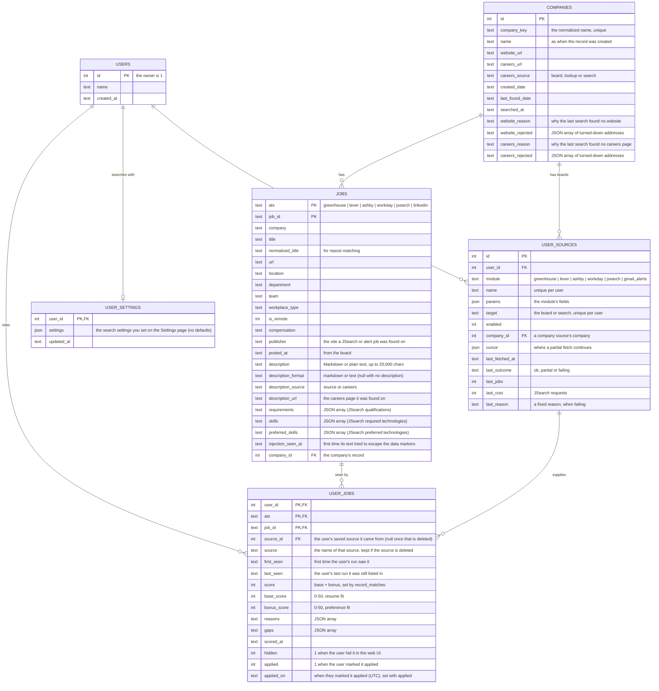

# Database structure

How myjobbot's MariaDB database is set up, what its tables hold, how descriptions are stored, and queries for looking inside.

[← README](../README.md)

## Setting up the database

Jobs, the companies they come from, scores, verdict history, the JSearch request log, your saved
sources and your search settings live in MariaDB (10.11 or later),
reached through [Kysely](https://kysely.dev) typed queries. `data/` keeps only `config.json` (the
runtime settings), `resume.md`, run traces and logs.

1. **Create a database** (any name), `CHARACTER SET utf8mb4` with any collation (the tables set
   their own), and a user with rights on just that database. The full stack
   ([`compose.full.yaml`](deploying.md#the-full-stack-composefullyaml)) does this for you. A test
   database for the integration tests is covered in [Developing](developing.md#tests-and-the-test-database).
2. **Set in `.env`**: `MYJOBBOT_DB_HOST`, `MYJOBBOT_DB_USER`, `MYJOBBOT_DB_PASSWORD`, and
   optionally `MYJOBBOT_DB_PORT` (3306) and `MYJOBBOT_DB_NAME` (`myjobbot`).
3. **Start anything**: the agent and the web UI create or update the tables on first use. Each
   schema change is a numbered step in `src/db/migrations/`, run once per database.

Every table compares text exactly (`utf8mb4_bin`), so job IDs that differ only in letter case
stay distinct, and every connection sets `utf8mb4`, so accents and emoji survive. Backups are the
MariaDB server's job, and a database backup holds your sources, search settings and accounts too
(`users`, `user_sources`, `user_settings` and the sign-in tables).

## Tables



`jobs` holds each posting once, shared by every user who finds it: what the posting says. `user_jobs`
holds each user's view of it: when their runs saw it, which of their sources it came from, their
score and their marks. A user only ever reads their own views, and a posting is pruned only once no
user has a view of it.

Company boards and JSearch save the job description (see below). Alert emails carry none: an alert job takes the description of a matching JSearch result,
or the one the [careers lookup](how-it-works.md#careers-lookup) finds, and otherwise has none
(`description_source` says which). JSearch also supplies requirement bullets and required and
preferred technologies, which are saved when present; the other sources don't have them as lists,
so those columns stay empty. Each scoring decision is also kept in the `verdicts` table (see
[How scoring works](how-it-works.md#how-scoring-works)).

The other tables, each listed in `src/db/schema.ts` with its columns in `src/db/schema/`:

| Tables | Hold |
|---|---|
| `verdicts` | every scoring decision, with its run and user |
| `api_calls` | the JSearch request log, for the monthly budget |
| `careers_audit` | each careers lookup step: addresses and sizes, never page text |
| `gmail_connection`, `gmail_alert_state` | each user's Gmail address and sealed app password, and where reading their alerts left off |
| `rescore_runs`, `rescore_steps` | each re-score, with its user, and its steps, shown as its Log |
| `resumes`, `resume_profiles` | each user's uploaded resume text and its extracted profile |
| `agent_runs`, `run_users` | each run with its heartbeat, outcome and totals, and each user's part of it, kept 90 days ([Monitoring](how-it-works.md#monitoring)) |
| `source_fetches` | each fetch or planned skip of a saved source: module, outcome, fixed reason, counts, duration; kept 90 days, removed with its source |
| `mail_sends` | each mail send's kind, outcome and fixed reason, never its address or text; kept 90 days |
| `users.deactivated_at`, `users.delete_after` | when an account was deactivated, and when its requested deletion is due ([Deactivating and deleting](how-it-works.md#deactivating-and-deleting)); deleting an account clears it from `account_codes` (`created_by`, `used_by` set null), which keep their codes |
| `sign_in_methods`, `hardware_keys`, `recovery_codes`, `sessions`, `account_codes`, `email_tokens`, `auth_challenges`, `auth_attempts`, `security_events` | accounts and signing in (see [Accounts and signing in](how-it-works.md#accounts-and-signing-in)) |

## How descriptions are stored

Sources that send HTML have it converted to **Markdown** before it is stored
([turndown](https://github.com/mixmark-io/turndown), `src/descriptions/toMarkdown.ts`), so the
posting's headings, lists and emphasis survive:

| Source | What is stored |
|---|---|
| Greenhouse | Markdown from its HTML (sent escaped, decoded once) |
| Ashby | Markdown from `descriptionHtml` |
| Gem | Markdown from its HTML (sent raw) |
| Lever | Markdown of the whole posting: the opening, each list ("Requirements"…) under its own heading, then the closing section |
| Careers lookup | Markdown of the job page (a Workday or other board page's own posting, or the downloaded or rendered page without its menus, header, footer or hidden parts) |
| JSearch | Plain text, as JSearch sends it |

`description_format` says which a row holds; rows stored before Markdown, and JSearch's, stay
plain text and always show as plain text.

- **Only safe formatting is kept.** Scripts, styles, frames, forms, media and images are dropped
  with their contents; other wrappers keep their text; links are kept only for `http(s)` addresses;
  text that merely looks like HTML or Markdown is escaped. At most 20,000 characters, cut at a line
  break.
- **It is shown safely.** The panel renders it with
  [react-markdown](https://github.com/remarkjs/react-markdown): raw HTML is never interpreted, no
  images load, and only `http(s)` links become links (new tab, no referrer).
- **The model reads a link-free copy.** `get_job_details` and description boosts see the Markdown with each
  link reduced to its words, so a link to `aws.example.com` doesn't count as "aws".
- **Scored again once.** The first time a scored job's description changes to Markdown, it is marked
  for scoring again, keeping its current score until then.
- **Only saved sources change.** Stored jobs from a source you've deleted or switched off are
  never fetched again, so they keep their plain text.

## Ghost postings and pruning

**Fishing-post detection:** "days open" counts from the oldest date the bot has, either
`posted_at` or `first_seen`, across all rows with the same company and normalized title.
That way a job reposted under a new ID still shows its true age. Over 60 days
(`ghost_threshold_days`) sets `possible_ghost: true`, and the model lowers its score a
little. After each run, once every user has had their turn, a user's views not seen for 90 days
(`job_retention_days`) are pruned, except jobs they've marked applied, which are kept with their
scoring history; a posting goes once no user has a view of it. Company records are never pruned.

## Useful queries

The careers lookup's audit log: why lookups ended without a description, the latest steps, and the
careers pages found:

```sql
SELECT reason, COUNT(*) FROM careers_audit WHERE warning = 1 GROUP BY reason;
SELECT at, company, step, outcome, reason, url FROM careers_audit ORDER BY id DESC LIMIT 50;
SELECT name, careers_url, careers_source FROM companies WHERE careers_url IS NOT NULL;
```

Company records: companies still missing a careers page, and where the pages came from:

```sql
SELECT name, careers_reason, careers_rejected, searched_at FROM companies WHERE careers_url IS NULL ORDER BY last_found_date DESC;
SELECT careers_source, COUNT(*) FROM companies GROUP BY careers_source;
```

## Coming from SQLite

Copy an old SQLite database across once, with the agent stopped:

```bash
sqlite3 data/myjobbot.db ".backup 'data/myjobbot-pre-mariadb.db'"
npm start -- import-sqlite data/myjobbot-pre-mariadb.db
```

The import is all or nothing. It refuses a database that already has rows, and any value too long
for its column, and it checks counts and a sample before committing.
