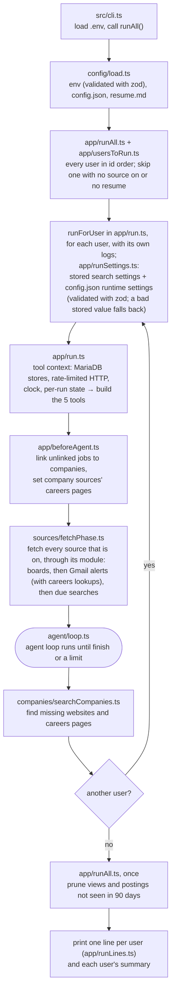
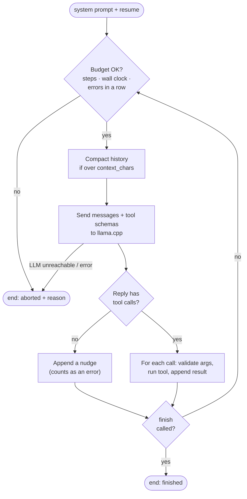
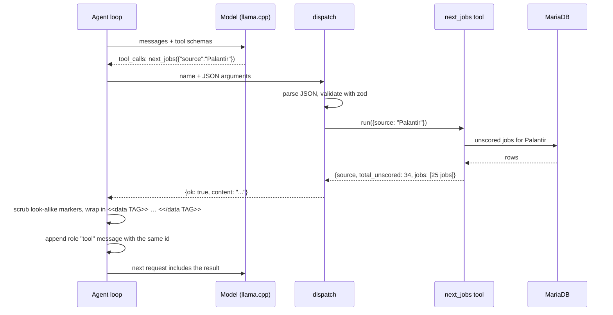
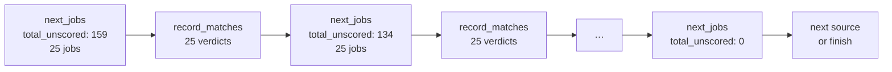
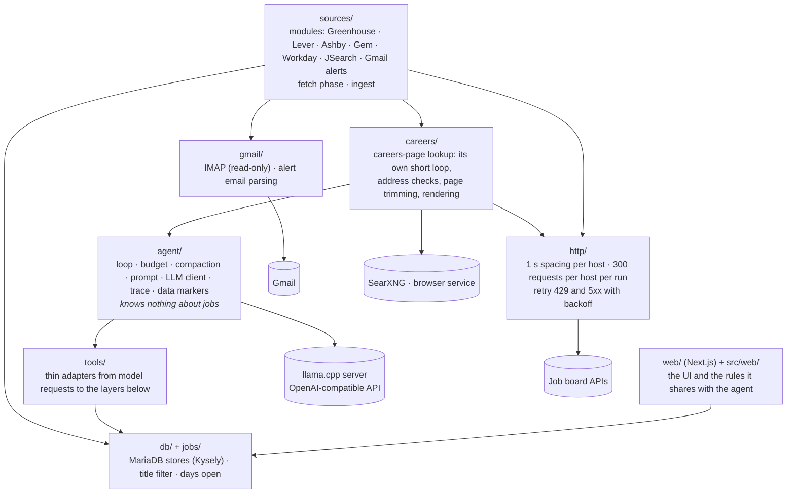
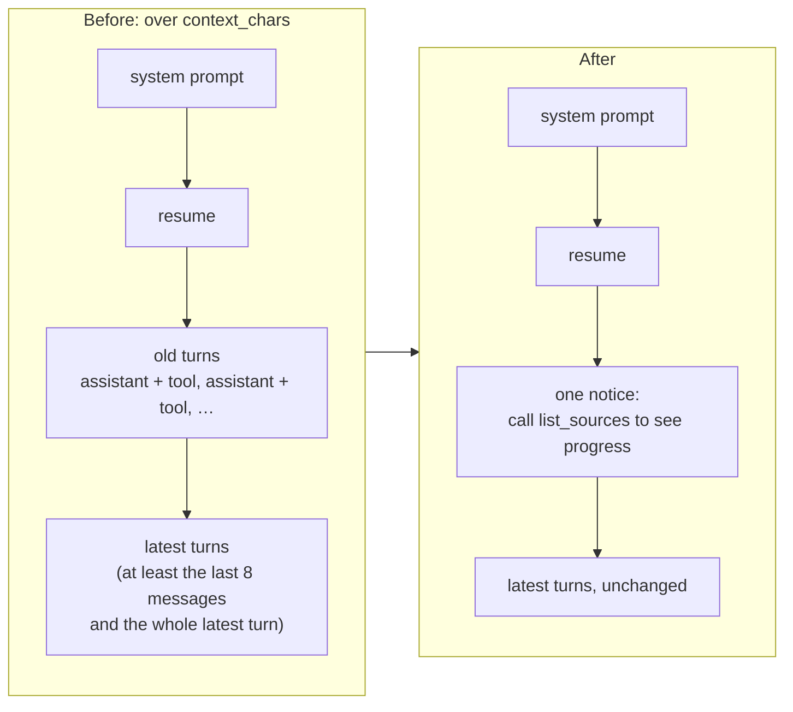

# How it works

How myjobbot fetches, looks up and scores jobs, what the web UI shows and does, how accounts work, and every setting.

[← README](../README.md)

## The big idea

myjobbot is **an LLM in a loop with tools**. The model never touches the internet or the
database directly. Before it starts, plain code fetches every source that is on; the model then
only scores, and can only ask to call one of five tools. The TypeScript code decides
whether that's allowed, runs it, and hands the result back. The [careers lookup](#careers-lookup)
reuses the same loop for a short side conversation per job, with three tools of its own; even
there the model only picks numbered links, and the code decides which addresses may be opened.

**Outside text is fenced off as data.** Job boards, alert emails and web pages are written by
other people, and any of them could carry instructions aimed at the model. Every result of a tool
that returns such text (`next_jobs`, `get_job_details`, `search_careers`, `open_link`) reaches
the model between two markers, `<<data TAG>>` and `<</data TAG>>`, where `TAG` comes from the
run's random id, so nothing written before the run can match it. Both system prompts say that
anything between the markers is data to read, never instructions to follow. Before wrapping, the
code removes anything in the text that looks like a marker, so the text can't close its own
block early; the job it came from gets a "⚠ tried to escape the data markers" note in the web UI,
and is still scored normally. This is a second layer: budgets, numbered links, address checks and
score ranges stay enforced in code whatever the model reads. Text that spells a marker with
look-alike Unicode characters or a typed-out escape sequence isn't caught.

- **The model** decides what to do next.
- **The code** does the work and enforces every limit.

## One run, start to finish



## The loop

The loop lives in `src/agent/loop.ts`, a little over 100 lines. It starts with two messages:
the system prompt (the rules for the job, from `src/agent/prompt.ts`) and your resume.
Then it repeats one step.



A typical run makes this sequence of calls:

```
list_sources → next_jobs → record_matches → next_jobs → record_matches → … → next_jobs → finish
```

## A tool call, up close

Every tool is defined with a zod schema (`src/tools/tool.ts`). `defineTool` turns it into
JSON Schema, which goes to the model in the `tools` field of every request. That is how the
model knows `next_jobs` takes `{source: string}`.



Every tool declares whether its results carry outside text (`outsideText` in `defineTool`).
For those, the loop (`src/agent/wrapped.ts`) wraps the result in the run's data markers before
the model sees it; the trace keeps the result as it was, with `wrapped: true`.

**Errors are data, not crashes.** `dispatch` never throws. Bad arguments, an unknown tool,
or a source name that doesn't exist all come back to the model as `{"error": "…"}` (capped at 2,000
characters), so the model can correct itself. That self-correction is most of why agents
work. Three failures in a row and the code ends the run.

## The five tools

| Tool | What it does |
|---|---|
| `list_sources` | Each source that is on, with its module, how this run's fetch went (`fetch`: `ok`, `partial`, or `failing` or `skipped` with a `reason`, such as a search that isn't due) and `total_unscored` |
| `next_jobs` | Returns **at most 25** of one source's unscored jobs that pass the title filter, plus `total_unscored`. It fetches nothing: every source was fetched before the model's first turn |
| `record_matches` | Saves up to 25 verdicts in one call: a `base` (0–50, resume fit) and a `bonus` (0–50, preference fit) that code sums into the score, with reasons and gaps |
| `get_job_details` | One job's metadata plus its description (first 6,000 characters, Markdown without link addresses, or plain text) and any requirements and skills. The prompt asks the model to call it for jobs that look like a plausible fit before scoring them; the result arrives inside the run's data markers |
| `finish` | Records the model's summary and ends the loop. Refused, with a list of what's left, while any source still has unscored jobs |

**Paging needs no page numbers.** The model scores a page and calls `next_jobs` again.
The database only returns jobs that are still unscored, so each call gets the next batch
until `total_unscored` is 0.



**The fetch phase** (`src/sources/fetchPhase.ts`) runs before the agent, one source at a time:
company boards first, then Gmail alerts, then searches. Each module yields pages of jobs with
their cost. Shared code stores them under the source (`src/sources/ingest.ts`, which drops a
search's excluded publishers and copies of jobs a company board already supplied), records JSearch
requests in `api_calls`, and keeps the source's last fetch on its row. Each fetch is a
`source_fetch` trace event; a source that fails gets a fixed reason, shows "failing" on Settings,
and doesn't stop the others. A skipped source is a `source_skipped` event saying why.

## The plain-code layers

Everything below the agent is ordinary, deterministic code.



- **Sources:** each module (`src/sources/module.ts`) declares its fields (a zod schema that also
  draws its Settings form), what it needs (`JSEARCH_API_KEY`, Gmail), its limits, how to read a
  pasted link, and a paged `fetch` that maps the source's answers to a common `Job` shape. Modules
  are listed in `MODULES` (`src/sources/registry.ts`), make requests only through the run's
  address-checked client, store nothing themselves, and fail with fixed reasons.
- **HTTP:** requests to the same site are at least 1 second apart and capped at 300 per site per run,
  and 429 and 5xx responses are retried with backoff that honors `Retry-After`. A looping
  agent can't hammer a job board.
- **Title filter:** postings like sales, recruiting and management are stored but never
  shown to the model, which saves steps. Include terms match word prefixes ("engineer"
  matches "Engineering"); exclude terms match whole words ("intern" rejects "Interns" but
  not "Internal"). Setting `exclude` replaces the default list; to keep the defaults and add
  your own terms, use `extra_exclude`.

## Context compaction

Long runs would overflow the model's context, so history is trimmed. This is safe because
**the database, not the conversation, is the agent's memory**: tools always return current
state.



- The kept part always starts on an assistant message, so no tool result is left without
  the request that produced it.
- Later overflows fold the old notice in, so the start of the conversation (system prompt,
  resume, notice) stays byte-identical and llama.cpp's prompt cache keeps working.
- After compaction the model calls `list_sources` to see which sources are done.

## How scoring works

A job's score is decided in four stages. Only the third involves the model.

**1. Filters decide what the model sees** (before scoring, in code). `next_jobs` offers only
jobs whose company isn't in `exclude_companies`, whose title passes `title_filter` (an include term,
matched at the start of a word, and no exclude term, matched as a whole word), and whose description
passes `body_filter` (one of its include terms when there are any, and none of its exclude terms,
all matched as whole words or phrases in the text the model reads). A job with no description yet
passes the body filter. The three are checked in that order (`filterMatch`,
`src/jobs/filterMatch.ts`), so All jobs names the first that hides a job. Filtered jobs are stored
but never scored. A filter you add later doesn't change jobs already scored, but Recommended checks
every job against the filters as they stand, so a scored job a filter now hides leaves it at once
(All jobs keeps it, with its score and the filter's note) and comes back if you remove the term.
Re-score a job to have the filter clear its score.

**2. The model reads what looks promising.** `next_jobs` returns metadata only. For each job
whose title, seniority and location could plausibly fit, the prompt asks the model to call
`get_job_details` and read the description (first 6,000 characters) before scoring.

**3. The model scores with a rubric, in two parts** (`src/agent/rubric.ts`, shared by runs and Re-score). For each job it
returns a `base` and a `bonus` to `record_matches`; code checks each is an integer from 0 to
50 and stores their sum as the score, keeping both parts.

| Part | Points | Rubric |
|---|---|---|
| **Base: fit with your resume** | **0–50** | |
| Stack | up to 25 | 20–25: the job's main languages and frameworks are ones the resume shows. 10–19: partial overlap or close neighbours. 0–9: mostly a different stack |
| Level | up to 15 | 15: the seniority the resume shows. 8: one step off. 0–4: far off (junior, or principal and director scope) |
| Kind of work | up to 10 | 10: the kind of work the resume shows strength in. 5: adjacent. 0: unrelated |
| **Bonus: fit with your `preferences`** | **0–50** | |
| Location | up to 25 | 25: location or remote terms the preferences ask for. 0: anything else, including remote roles limited to another country |
| Role | up to 15 | 15: the role and level the preferences ask for; less for roles the preferences say to score low |
| Other preferences | up to 10 | Anything else the preferences mention |

If the preferences say to score a job 0 (for example a company you won't work for), both parts
are 0. With a base of at most 50, a job needs bonus points to reach `match_threshold`: at a
threshold of 60, a perfect base still needs 10 bonus points; at 70 it needs 20, which in
practice means the location has to fit. Reasons and gaps are required from a score of 40 and
should name the rubric parts behind the numbers. `possible_ghost` (open over 60 days) lowers
the base slightly.

The rubric is written in terms of "the resume" and "the preferences", never specific
technologies, so editing `data/resume.md` or the `preferences` text changes what counts as a
fit without touching the prompt.

**4. Boosts and your choices adjust what's shown** (at display time, in the web UI). There are
two lists: a `title_boosts` term adds its points when it is found as a whole word in the job's
title, and a `description_boosts` term when it is found in its description (the link-free copy).
Each term adds its points only once, however often it appears; a term in both lists that is
found in both places adds them once, at the higher of its two values, and terms that differ only
in case or punctuation count as one. The total is capped at 100 ("model 62 · +15 senior +5
(title), typescript +10 (description)"). Recommended shows jobs whose boosted score is at
or above `match_threshold`, minus excluded companies and jobs you hid. None of this is stored,
so changing boosts or the threshold re-sorts every job on the next page load, without
re-scoring. The Reasoning tab always shows the model's own score.

**Every verdict is kept.** Each `record_matches` call also appends to the `verdicts` table with
the run ID, so re-scoring a job (for example after changing the rubric) never loses what the
model said before.

**What to expect from the model.** Scores come from a local 30B model sampling at temperature
0.7, so the same job can score differently on another run, and reasons are occasionally wrong.
The rubric narrows that spread; treat a score as a sort order, not a verdict.

## Design lessons built into it

1. **Limits live in code, not the prompt.** The step cap, the time cap, the error streak and
   the nudge are all enforced in `agent/budget.ts` and `agent/loop.ts`, and `finish` is
   refused while any source still has unscored jobs. The model can't argue
   its way past them.
2. **The database is the memory.** That's what makes compaction safe, and it's why a crashed
   run loses nothing: unscored jobs are offered again on the next run.
3. **Keep the prompt prefix stable** so a local model's prompt cache stays warm.
4. **The loop knows nothing about jobs.** Job knowledge lives in the tools and
   `agent/prompt.ts`. The same loop could run a different agent, and a fixed-order pipeline
   could call the same tools if the agent approach ever proves unreliable.
5. **Everything is traced.** Every model reply, tool call, nudge and compaction is appended
   to `data/runs/<timestamp>-<run_id>.jsonl`.

## Traces and logs

A run goes through every user in turn, and each user's part gets its own UUID (printed as
`user <id>: run <run id> finished after …`), so it has its own trace whose first event names the
user (`{"type":"user","userId":…}`). Every log line carries the id as `run_id`, and every file
name ends with it, so one user's files sort together:

| File | One line per |
|---|---|
| `data/runs/<timestamp>-<run_id>.jsonl` | Trace event: starting messages, model replies, tool calls and results, nudges, compactions, end |
| `log/<timestamp>-<run_id>.llm.jsonl` | Raw LLM response, including token usage and llama.cpp timings |
| `log/<timestamp>-<run_id>.jobs.jsonl` | Source fetch: source, module, job count, and the normalized jobs (descriptions omitted) |

Set `MYJOBBOT_LOG_DIR` to move the `log/` folder.

With `MYJOBBOT_LOG_STDOUT=1` each run also prints its trace and job log lines to stdout, one JSON
line per event with a `stream` field (`trace` or `jobs`), still writing the files. The dev stack
(`compose.yaml`) sets it, so `docker compose logs -f myjobbot web` follows scheduled runs and
re-scores as they happen. A command typed at a terminal (`docker compose exec web npm start -- …`)
isn't echoed, so its own output stays readable. The model log stays in its file only, since it
holds every model response. The trace holds the run's prompts, the resume included, so the dev
stack's container log does too.

To learn how a run went, read its trace in `data/runs/*.jsonl` top to bottom: it shows exactly
what the model saw and decided.

## The web UI

A Next.js app for browsing the database, with four tabs and a Settings page. Settings is where your
sources are added (see [Sources](sources.md)), where your search settings are made and changed (see
[Settings](#settings)), and where Gmail is connected (see [Gmail](sources.md#gmail-alerts)):

| Tab | Shows |
|---|---|
| **Recommended** | Jobs from your configured sources scoring at or above `match_threshold` (after boosts) and not yet marked applied, most recently posted first, with the model's reasons and gaps |
| **Applied** | Every job you've marked applied, most recently marked first, hidden ones included. Clearing a job's mark here takes it off the list |
| **All jobs** | Every job retrieved, scored or not, most recently posted first, including ones the title filter, the body filter or `exclude_companies` hid from the model |
| **Reasoning** | Every scoring decision with its run ID, newest first. Kept as history in the `verdicts` table, so re-scoring never overwrites the earlier reasoning |

### Hide

Each job row has a **Hide** button. Hiding sets the job's `hidden` flag: it disappears from
Recommended at once and stays hidden when the posting is fetched again. All jobs still lists it,
dimmed, with an **Unhide** button.

### Applied

Each row also starts with an **Applied** column: a blue **?** until you've applied, which you click
to mark the job applied, and then a green **✓**. Hovering the check shows the date you marked it, in
your browser's time zone. Clicking the check asks "Mark as not applied?" and, if you confirm, clears
the mark. Marking a job applied moves it off Recommended and onto the Applied tab (clearing the
mark moves it back); it doesn't change its score, it's independent of Hide, and the mark stays
through runs and re-scoring. Hiding, marking a job applied, Re-score, the Settings page and the
account pages are the UI's only writes; they accept requests from its own pages only.

### Job details

On Recommended and All jobs, a job's title opens a panel from the right, over
about 60% of the window, without leaving the list: you can still scroll, hide jobs or click
another title to switch. Its header, beside the title, has **Re-score** (see [Re-score](#re-score)), a green **Applied** button (which becomes
**Applied ✓**, and undoes the mark after the same confirmation), **Hide** (which hides the job as its
row's Hide does and closes the panel; it is greyed out for a job already hidden, which you bring back
with Unhide on All jobs) and **Close**. The panel has five sections:

- **Job**: company, location, remote and workplace terms, pay, source, posting age, whether
  you hid it, and when you marked it applied.
- **Score**: the total, the model's own score and its boosts (each term, its points and where it
  matched: title, description or both), the resume-fit and
  preference-fit parts, and the reasons and gaps.
- **Description**: the full text, with requirements and skills, and where it came from (the job's
  own listing, or the careers page the [careers lookup](#careers-lookup) found, linked). Descriptions
  stored as Markdown show formatted (headings, lists, emphasis, links opening in a new tab); plain
  text shows with its line breaks. See [How descriptions are stored](database.md#how-descriptions-are-stored).
- **Warnings**: only when text from the job tried to escape the model's data markers.
- **History**: every score and re-score the job has had, newest first, with its parts and run. A
  re-score that saved no score (filtered, failed or still running) shows that instead, and every
  re-score has **Log**, which opens its steps in the terminal (see [Re-score](#re-score)).

Close it with its button, Escape or a click outside it. The open job is in the address
(`?job=<board>:<id>`), so reload, back and forward keep it, and Ctrl/Cmd-click opens a job in a new
tab. The icon left of **Hide** opens the original posting. Reasoning keeps its titles as links to
the posting.

### Re-score

The panel's **Re-score** scores the job again at once, from its current
description against your current resume, preferences and filters. A terminal-style window opens
under the panel's header and shows each step as it happens, as `[  2.4s] <step>` lines after
`$ myjobbot rescore <board> <id>`: the filters checked, the careers search and each page opened
(with its address, size and how it was read), the model reading the job, the score saved and the
outcome. It never shows page or model text. The button reads "Re-scoring…" until the re-score ends;
then the panel shows the new score, reasons and gaps, and History gains a row (the old verdicts
stay). The terminal stays until you close it with its ×, open another job or close the panel. Use it after changing your preferences, your resume or a filter, since saved
filters only apply to jobs scored after them.
- **A job a filter now hides** (an excluded company, the title filter or the body filter) isn't
  sent to the model. Its score is cleared, the panel says which filter hides it, and it leaves
  Recommended; All jobs notes the filter. Its hidden and applied marks stay.
- **A job with no description** (a LinkedIn alert job) has its description looked up first with
  the [careers lookup](#careers-lookup), for at most 2 minutes. If nothing is found, it is scored
  from the alert, as a run does.
- **A failure** (the model can't be reached, say) keeps the old score and says so.

A re-score normally takes under 30 seconds (up to about 5 minutes with a lookup). It runs on the
server whether or not you watch: you can keep using the page, reload it or open other jobs.
Reopening the job while its re-score runs opens the terminal again, with the lines so far, and
follows it; pressing Re-score then follows the running one rather than starting another, since a
job has one re-score at a time. A re-score that hasn't ended after 10 minutes counts as failed.
If the live view drops, the terminal says so; reopen the log from History. It is traced like a
run, in its own `data/runs/` file.

### Scores, titles and paging

On Recommended and All jobs, hover over a score (or tab to it) for its breakdown ("base 38 +
bonus 40", plus any boosts, each with its points and where it matched); Reasoning prints it in full. Titles longer than 64 characters end in
"…", with the full title on hover. See
[How scoring works](#how-scoring-works) for what the numbers mean.

Each tab shows 100 rows and loads the next 100 as you scroll (or via "Load more"). Search settings
you save on the Settings page, and edits to `data/config.json`, show up on the next page load. Set `MYJOBBOT_PORT` to change the port. Every
page needs a sign-in (see [Accounts and signing in](#accounts-and-signing-in)). The web UI needs `data/` and, for Re-score, the same `LLM_*`
settings as a run (and `MYJOBBOT_SEARXNG_URL` for its careers lookup).

### Which hosts may connect

Every request must name the UI in its `Host`, or it gets 421; that
stops other websites reaching it through DNS tricks. By default that's `localhost` and
`127.0.0.1` on `MYJOBBOT_PORT`. To open it from another machine, list every `host:port` you use
in `MYJOBBOT_HOSTS`, for example `MYJOBBOT_HOSTS=myserver.lan:8080,192.168.1.20:8080`.

## Accounts and signing in

Every page needs a sign-in, except `/sign-in`, `/create-account` and `/link`. A signed-out request
gets only a redirect to the sign-in page (or `401 Signed out` for data), never any job data, and
signed-in pages are never stored by the browser. Each account is a separate user: their own
sources, search settings, resume, Gmail connection, scores, hidden and applied marks and re-score
history, and no one else's, admins included; only Settings' Admin section is for admins. A job
posting found by several users is stored once and shared, with each user's view of it (when they
first and last saw it, its score and marks) kept apart, so a description found for one user is
never looked up again for another. The JSearch monthly budget is the deployment's, counted across
every user's searches. `data/resume.md` is user 1's only: any other user needs to upload one.

The first admin is made from the command line ([`account init`](cli.md#account)). The settings a
deployment needs for sign-in, the base URL, account mail and the server key, are in
[Account settings](deploying.md#account-settings); the per-address limits behind proxies are in
[Proxies and the sign-in limits](deploying.md#proxies-and-the-sign-in-limits).

**New accounts.** An admin makes an account creation code on Settings → Admin (shown once, works
once, for 7 days) and gives it to someone, who uses it on `/create-account`. Admins grant or remove
the admin mark there (never the last one) and can change an account's email for an owner who lost
theirs.

**Ways of signing in**, each switched on and set up on the Account tab; any one usable way signs in:

| Way | Notes |
|---|---|
| Password | changed with the current one; every other sign-in ends |
| Email me a link | a one-time link, 15 minutes; "Send test email" checks mail |
| Authenticator app | any TOTP app (scan the QR code); each code works once |
| Hardware key | FIDO2 keys that store a passkey (YubiKey 5 and the like), by name |

The first app or key gives ten one-time recovery codes, shown once. "Forgot password" mails a reset
link (30 minutes) that ends every sign-in. Five failures for an email in 15 minutes lock it for 15
minutes. Sensitive changes ask "Confirm it's you" when the last proof is over 10 minutes old (by any
way, or a link by email). The Account tab also lists every live sign-in with its device's OS, IP
address and location (the browser's, rounded to about 10 km, when shared; else from the IP), with
Sign out for each, and the last 20 security events, each also mailed as a notice where it matters.

**Security in brief.** Changes are accepted only from the UI's own origin and carry a
`SameSite=Strict` forgery cookie tied to the sign-in; every server action checks the sign-in
itself; pages carry a nonce content policy, refuse framing and send no referrer from `/link`.
Passwords are Argon2id digests, one-time values are stored only as digests and spent in the
statement that checks them, and authenticator secrets are sealed. Answers never say whether an
email has an account, and error pages show a fixed message (the detail stays in the server log).

### Deactivating and deleting

The Account tab's **Account status** section changes your own account only:

- **Deactivate account** (asks once) stops runs fetching, looking up and scoring jobs for you and
  removes your Gmail connection. You still sign in and see, hide and mark your jobs, and change
  settings, sources and resume; Re-score and connecting Gmail say to reactivate first.
  **Reactivate** starts the runs again (connect Gmail again yourself). Every page shows a banner
  while you are deactivated.
- **Delete account** asks you to confirm it's you, says what will be removed and when, and asks
  for your email. The account is deactivated at once and deleted 30 days later; until then every
  page shows the date and the Account tab has **Cancel deletion**, which leaves you deactivated.
  The run that comes after the date deletes everything that is only yours (your jobs' scores and
  marks, history, re-score logs, sources, settings, resume and profile, Gmail connection and ways
  of signing in) in one step, then mails a notice; shared postings, companies and other accounts
  are untouched. Run traces and logs in `data/` stay, naming you by id only. Your email can make a
  new account afterwards, which starts empty.
- **The only admin** can deactivate but not delete; make another admin first. A deletion that
  comes due while you are the only admin is held until another admin exists or you cancel it.

With account mail set up, each of these changes is mailed as a notice.

## Resume and profile

The **Resume** section of the Settings page, under Preferences, holds the resume the model scores
against. Upload a Markdown, text, PDF or Word (`.docx`) file of up to 5 MB; only its text is kept
(up to 100,000 characters), in the database, and it is shown back as plain text, never rendered.
A scanned PDF with no text, another file type, or a file too large is refused with the reason, and
the resume you had stays. A new upload replaces the old one. Until you upload one, runs and
Re-score use `data/resume.md`; with neither, they stop and say a resume is needed.

- **Extract profile** has the model read the uploaded resume (at most 3 minutes) and record a
  profile: a summary written as job preferences, and your skills in three groups, Engineering,
  People and Project, each skill once. The resume reaches the model only inside the data markers,
  and the model's answer is checked before anything is stored; a failure changes nothing. The log
  of the model's responses keeps only token counts for an extraction.
- **Edit the profile**: the summary is saved when you leave it, and each skill change (add, remove,
  move to another group) is saved at once. A skill already listed is refused. After a new upload
  the profile says "From an earlier resume" until you extract again; **Extract again** asks first
  when you've edited it.
- **Use summary in Preferences** copies the summary into the Preferences box for you to edit and
  save there; it never saves your preferences by itself.
- **What the model reads about you**, in the Scoring section, chooses what every run and Re-score
  gives the model: **Your resume** (the default), **Your resume and profile** (the resume, then the
  skills by group as what to look for in a posting) or **Your profile only** (the summary and the
  skills). Each is inside the data markers. With no profile, every choice reads the resume.
  Measure a choice with the evals' `--view` before you switch it (see [Evals](cli.md#evals)).

## Settings

Settings live in two places:
- **Search settings** (what you look for, and how jobs are filtered and ranked) are stored in the
  database, one set per user (today just you, the owner), and changed only on the web UI's
  **Settings** page. It has four sections:
  - **Sources**: your saved sources (see [Sources](sources.md)), each saved on its own;
  - **Preferences**: the preferences text;
  - **Scoring**: the match threshold, and the Title Boosts and Description Boosts lists side by
    side;
  - **Filters**: the title filter, the body filter (description terms) and excluded companies and
    publishers.

  Each section has its own Save. Only what you set is stored, so defaults still apply to the
  rest; the page has no reset-to-default buttons. A save
  is checked together with the rest of your settings and the current `config.json`, then stores
  that section whole or changes nothing. A refused save shows each problem beside its field or row
  and keeps your edits. The last save wins.
- **Runtime settings** (limits, budgets, lifetimes, Gmail senders) stay in `data/config.json`. Edit
  the file; a bad value stops the run with its message.

Company boards and saved searches are no longer settings: `companies` and `searches` became saved
sources (see [Sources](sources.md)), moved into `user_sources` once by the upgrade. If either is still
in `data/config.json` or the stored settings, it is ignored, and the Settings page says it can be
removed.

Search settings left in `data/config.json` (from before they moved to the database) are never used.
The Settings page, and each run's trace (`settings_file_ignored`), says they can be removed from
the file. A stored search setting that later breaks a rule (say, after an upgrade tightens one)
falls back on its own: a bad value takes its default and a bad list entry is left out. The Settings
page's notices panel and the run's trace (`settings_fallback`) say which and why; saving that
section stores the value in effect and clears the notice.

**Search settings (stored in the database)**

| Setting | Default | What it controls |
|---|---|---|
| `jsearch.exclude_publishers` | `[]` | Job boards whose JSearch results are dropped before storing. A name matches the publisher as whole words, any case: `"dailyremote"` drops results published by DailyRemote (use full board names: `"remote"` would also drop Remote Rocketship). An entry with a dot is a domain matched against the apply link's host: `"jobmesh.io"` drops links on exactly `jobmesh.io`, and `"*.trabajo.org"` drops `trabajo.org` and every subdomain. So `"remote.co"` matches by link, not by name. A malformed domain, or a bare suffix like `"*.com"`, is refused when you save it on the Settings page; one already stored is left out, with a notice |
| `preferences` | `""` | Free text added to the system prompt |
| `match_threshold` | 70 | Score at which a job counts as a match |
| `title_filter.include` / `.exclude` | engineering terms / sales, recruiting, management, interns | Which postings the model sees |
| `title_filter.extra_exclude` | `[]` | More exclude terms, added to `exclude` instead of replacing it |
| `body_filter.include` | `[]` | "Description must include one of" on the Settings page: when it has terms, a job whose description mentions none of them isn't scored. Whole words or phrases, any case, punctuation as spaces, an optional plural "s" (`"go"` never matches "good") |
| `body_filter.exclude` | `[]` | "Description must not include": a job whose description mentions one of these isn't scored (`"security clearance"` matches "Security-Clearance"). It wins over `include`. A job with no description passes both lists; already-scored jobs keep their score |
| `exclude_companies` | `[]` | Company names to hide (whole words, any case: `"nvidia"` hides "NVIDIA Corporation"). Their jobs are stored but never scored, and they drop out of Recommended |
| `title_boosts` | `{}` | Points (1-100) added to the score when a term appears as a whole word in the job's title (each term counted once) |
| `description_boosts` | `{}` | Points (1-100) added when a term appears as a whole word in the job's description (each term counted once). A term in both lists found in both places counts once, at the higher value. Upgrading copies your existing `title_boosts` here once (step 016) |

**Runtime settings (`data/config.json`)**

| Setting | Default | What it controls |
|---|---|---|
| `jsearch.monthly_request_cap` | 190 | JSearch requests allowed per calendar month (free tier is 200) |
| `jsearch.refresh_hours` | 24 | Each search calls JSearch at most once per this many hours (with 15 minutes' leeway, so runs exactly this far apart always refresh). Set it to the gap between scheduled runs to refresh on every run |
| `jsearch.date_posted` | `3days` | Only postings this recent: `today`, `3days`, `7days`, `30days` |
| `ghost_threshold_days` | 60 | Days open before `possible_ghost` |
| `job_retention_days` | 90 | Days unseen before a job row is pruned (must exceed the ghost threshold); jobs marked applied are never pruned |
| `agent.max_steps` | 600 | Step cap per run |
| `agent.max_wall_clock_min` | 120 | Time cap per run |
| `agent.max_consecutive_tool_errors` | 3 | Errors in a row before aborting |
| `agent.context_chars` | 160000 | History size that triggers compaction |
| `http.*` | 1 s spacing, 300 requests per host per run, 2 retries, 30 s timeout | Politeness toward job boards |
| `careers_lookup.max_per_run` / `.max_total_minutes` | 10 / 30 | Careers lookups per run, and the total time they may take |
| `careers_lookup.max_minutes` | 5 | Time budget for one job's lookup (checked between model turns) |
| `careers_lookup.page_chars` | 12000 | Characters of trimmed page (or search results) handed to the model |
| `careers_lookup.search_results` | 10 | SearXNG results offered per company |
| `careers_lookup.max_download_kb` | 2048 | Bytes read from one page before it is cut |
| `careers_lookup.render_seconds` | 15 | Time limit for rendering one page (5–60) |
| `careers_lookup.skip_hosts` | aggregators | Hosts (and their subdomains) whose search results are dropped |
| `careers_lookup.lan_probe_url` | unset | A LAN address the browser service must not reach, checked once per run |
| `company_search.max_per_run` | 50 | Companies searched for a website and careers page per run (0 turns the search off) |
| `gmail.alert_senders` | LinkedIn and Indeed alert addresses | Email addresses or domains whose mail counts as a job alert, both for runs (the "Gmail alerts" source) and for the Gmail panel's Check now. Anything else (quotes, spaces, brackets, a leading `-`) stops the config from loading, like any other config error. "Gmail alerts" is a reserved source name, so no other source may use it |

## Careers lookup

Alert jobs arrive with a title, company and location but no description, so the model has little
to score. When `MYJOBBOT_SEARXNG_URL` is set, fetching the Gmail alerts source looks those jobs up
on the employer's own careers page before the agent scores them:

1. **Which jobs**: unscored alert jobs that pass the title filter, still have no description
   after JSearch, and haven't been looked up before. At most `careers_lookup.max_per_run` a run,
   and `careers_lookup.max_total_minutes` in total, one at a time. Jobs whose lookup before 010
   ended on an unreadable page (or gave up) get one more try, even if they were scored since; a
   description found that way makes the job be scored again.
2. **How**: each job gets its own short conversation with the model, with three tools:
   `search_careers` (SearXNG, "<company> careers"), `open_link` (opens a numbered link as a careers
   page or as the job's own page, at most 4 per job) and `finish_lookup`. The model picks among
   numbered links; it **never types an address**. The code only opens public `http(s)` addresses
   on the default port, checks every redirect again, and refuses anything on your LAN. Search
   results on aggregators (`careers_lookup.skip_hosts`: Glassdoor, ZipRecruiter, Indeed,
   LinkedIn, Built In, Teamwork Online) are dropped, a second search in one lookup is refused, and
   a page that fails to open is reported to the model without ending the lookup.
3. **Pages are trimmed** before the model sees them: scripts, styles, navigation, headers,
   footers, forms and hidden elements go, leaving text and job links, at most
   `careers_lookup.page_chars` (12,000) characters. With up to four pages a lookup can pass the
   56,000-character context budget, in which case the oldest page is compacted away, so it fits a
   model served from a 16GB graphics card.
4. **Results**: a found job page becomes the job's description, as Markdown converted from the
   page's HTML without its navigation, header, footer or hidden parts (or, from a board's own data,
   the posting's own description), and the agent scores it as usual (`get_job_details` says
   `description_from: "careers page"`). The careers page that led to it is kept on the company's
   record (`companies.careers_url`), so later jobs there skip the search. A company source's board page
   is never replaced. A remembered page that stops working is cleared and added to the company's
   turned-down addresses, so the company search never stores it again.

**How a page is read**, in order (each open's audit row says which, in `page_source`):

1. **Board data**: links on Ashby, Gem, Greenhouse, Lever and Workday (`*.myworkdayjobs.com`) are read
   from the board's own published data, through the same source modules as the job-board sources. A careers page becomes the board's job list (Workday: its search for the
   sought title), a job page the posting itself. If that fails, the page is downloaded instead
   (`fallback = 'board_failed'`).
2. **Download**: the page's HTML, trimmed. A careers page that links to no board but names exactly
   one in its HTML (a script or frame that fills its job list, as BigPanda's names Gem) is read
   from that board's data instead, under the page's own address.
3. **Rendering**: when the download is unreadable (a job page with no text, or a careers page
   with no job links, as JavaScript-built sites give), the page is rendered in a browser service
   and trimmed the same way. Every request the page makes is checked against the same address
   rules, redirects included; images, fonts and media aren't loaded; each page gets a fresh
   browser context; rendering stops after `careers_lookup.render_seconds`. Without a browser
   service (`MYJOBBOT_BROWSER_URL` unset) or after it fails once in a run, unreadable pages stay
   empty (`fallback = 'render_off'` / `'render_failed'`) and the run summary says so.

Following a listing's next pages isn't done yet; the audit log notes when a page seems to continue.

Rendering needs the [browser service](deploying.md#the-browser-service), and the search needs a
[SearXNG](deploying.md#searxng) server; Deploying covers setting up both.

**Audit log**: every step is a row in `careers_audit` (addresses and sizes, never page text).
Every lookup that ends without a description has `warning = 1` and a fixed `reason`; see
[Useful queries](database.md#useful-queries) to read it.

## Company records

Every company myjobbot finds jobs from has one row in `companies`, and every stored job points at
it (`jobs.company_id`). Names are matched loosely: "Acme", "ACME, Inc." and "Acme LLC" are one
company. Excluded companies are recorded too, though their jobs stay out of scoring. A record is
kept after its jobs are pruned.

- **Recording**: each fetch records its companies before storing the jobs; seeing a job again moves
  the company's `last_found_date` forward. On the first run after the upgrade, every stored job is
  linked, oldest first, so a record created then is named after its oldest job. A record keeps the
  name it was created with. Jobs whose company name has no letters or digits get no record and stay
  unlinked.
- **Careers pages** come from three places, in this order of precedence (`careers_source`):
  - `board`: a saved company source's board (see [Sources](sources.md));
  - `lookup`: the page the careers lookup found a job on;
  - `search`: the search below.
- **Search**: after each run's agent, up to `company_search.max_per_run` (50) companies still
  missing an address are searched in SearXNG, most recently found first, at most once a day each.
  It sends at most two queries per company (`"<name>"`, then `"<name> careers"`) and makes no model
  calls. The rules:
  - **Website**: the first result whose site name equals the company's name, or starts with it when
    the name has four or more characters.
  - **Careers page**: a careers or jobs page on that site or a subdomain, or the company's own job
    board page.
  - **Never stored**: job aggregators (`careers_lookup.skip_hosts`), IP or local addresses, and, for
    careers pages, an address already turned down.
- **Misses** keep why: `website_reason` / `careers_reason` (`search_unavailable`, `no_results` or
  `no_match`), plus the addresses turned down: up to five from the last website search, and for
  careers pages up to 20 remembered across searches (five per search, plus any dead page the
  careers lookup cleared). Each search is in the run's trace as a
  `company_search` event. When SearXNG is down or unset, the run still finishes.

[Useful queries](database.md#useful-queries) shows how to look at company records.
